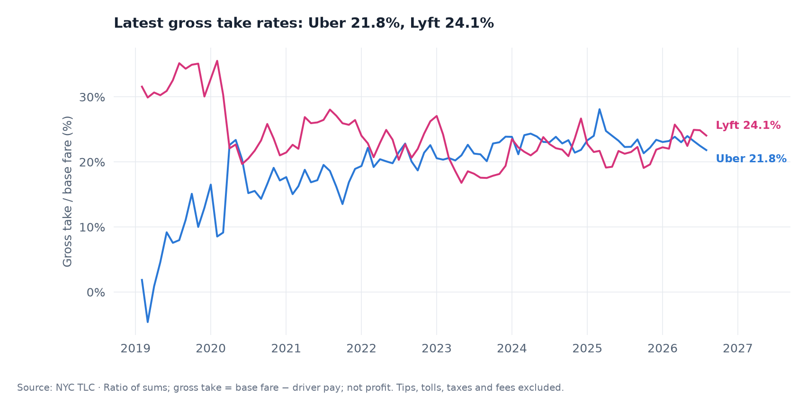
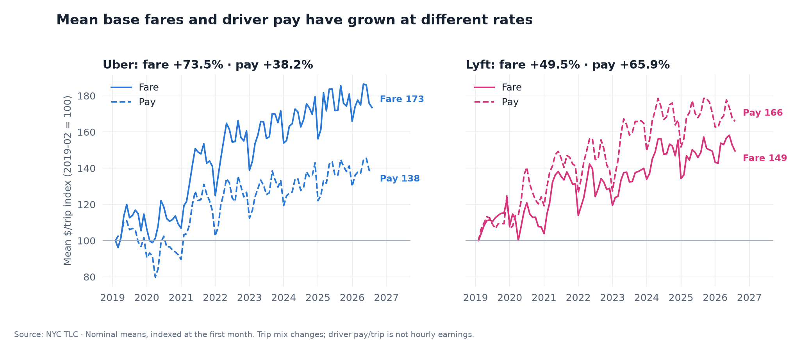
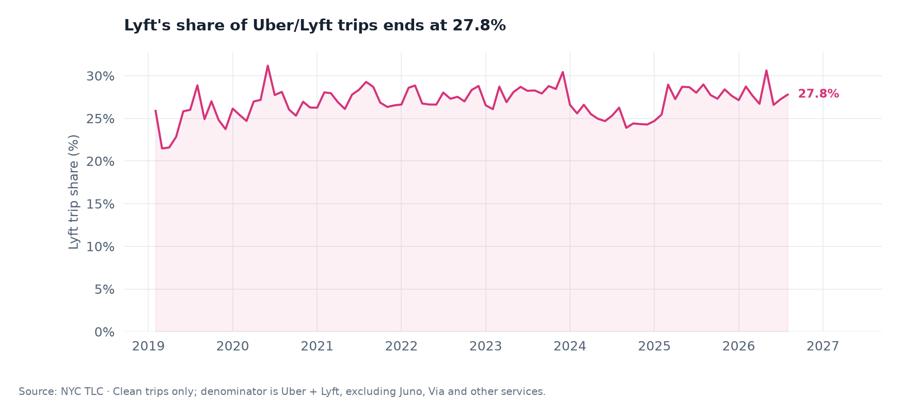
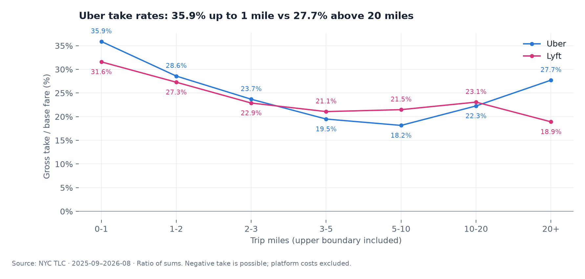
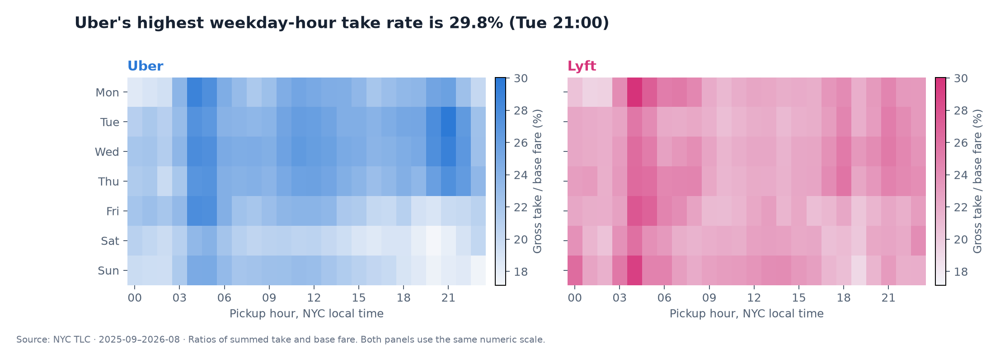
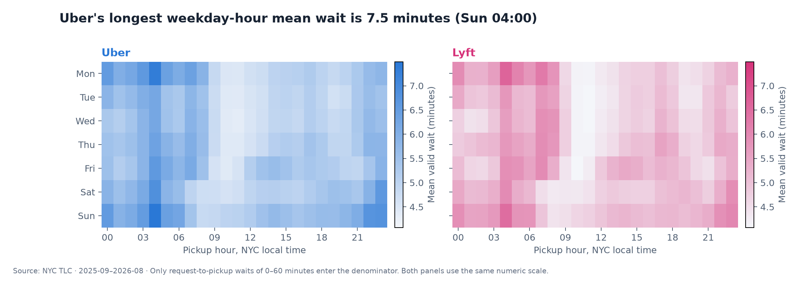
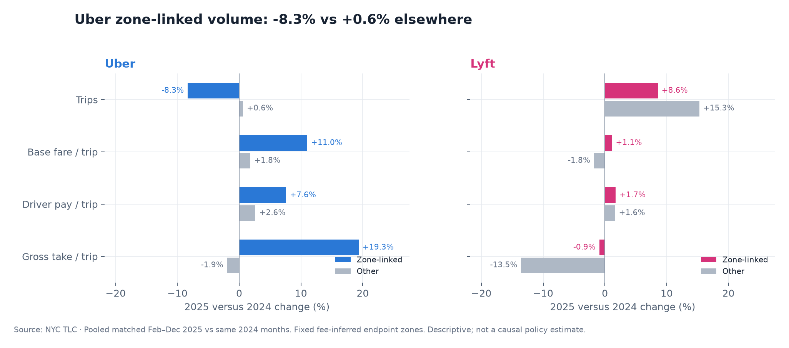
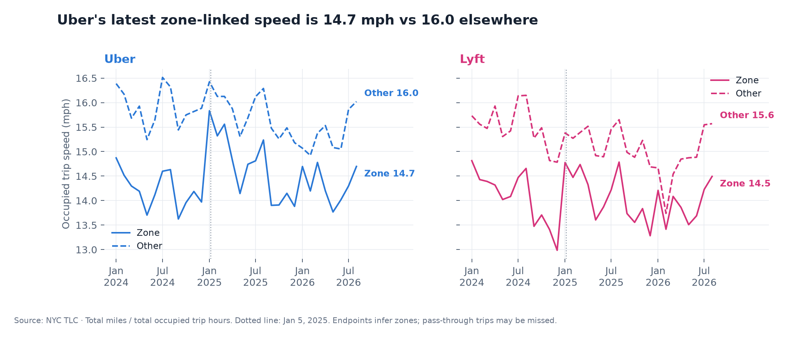

# NYC Rideshare Economics: Uber vs Lyft

**Independent project · NYC TLC public data · Python, DuckDB, SQL, pandas, matplotlib**

How much of each NYC Uber/Lyft base fare remains after driver pay, and how did fares, pay and travel conditions change around congestion pricing?

## Key findings

- In 2026-08, Uber's gross take rate was 21.8% ($5.98/trip), versus Lyft's 24.1% ($6.16/trip).
- From 2019-02 to 2026-08, Uber's mean base fare per trip grew +73.5% and mean driver pay +38.2%; Lyft's fare grew +49.5% and driver pay +65.9%.
- Gross take rates have moved closer: in 2019-02 Lyft was 31.6% and Uber 1.9% (Uber was -4.6% in 2019-03). Since 2024, both companies' monthly rates have been roughly 19%–28%; in 2026-08, Uber was 21.8% and Lyft 24.1%. Uber's early take was unusually low, so growth comparisons using 2019-02 are sensitive to that starting point.
- Over the latest 12 months, Lyft handled 27.8% of Uber/Lyft trips; its mean gross take was $5.92/trip versus Uber's $6.43.
- For Uber trips up to 2 miles in the latest 12 months, gross take rate was 30.4%; driver pay exceeded base fare on 10.0% of trips.
- In matched Feb-Dec 2025 versus 2024 months, Uber's zone-linked speed changed +2.8%, versus -0.9% elsewhere: a +3.7 percentage-point descriptive gap.

## Charts










## Interactive explorer

[Open the bilingual explorer](https://hql7-luo.github.io/rideshare-platform-economics/) · [Strategy memo](docs/memo.md) · [Methods](docs/methodology.md) · [Source notes](docs/sources.md)

The standalone [HTML file](docs/index.html) also opens locally. It includes metric switching, hover details, distance and hour views, a congestion comparison, and a searchable pickup-zone table. It uses embedded data and no external chart service.

## Data and method

- Only [NYC TLC High Volume FHV trip records](https://www.nyc.gov/site/tlc/about/tlc-trip-record-data.page) and the official zone lookup feed the analysis. Companies: HV0003 Uber and HV0005 Lyft. Coverage: 2019-02 through 2026-08; 91 observed months. Recent snapshot: 2025-09 through 2026-08 (12 observed months). Monthly rows are processed one file at a time; raw files are deleted and excluded from git. Completed monthly summaries are reused on reruns.
- Coverage mode from the download manifest: **Full monthly coverage**. Earlier sampled months are observations, not annual totals. The exact month list and download receipts are in `data/processed/manifest.json`.
- Keep fare > 0, driver pay ≥ 0, 0 < miles ≤ 100, duration 1–240 minutes, and pickup month matching the file. Valid waits are 0–60 minutes; invalid waits are excluded from the wait denominator only. Missing historical optional fee fields are zero. Record raw and retained counts by company and month.
- **Gross take = base passenger fare − driver pay. Take rate = sum(take) / sum(base fare).** Neither includes tips, tolls, taxes or surcharges. A group rate is a ratio of totals, not a mean of trip rates. Fare and pay growth compare mean dollars/trip in 2019-02 with 2026-08; dollars are nominal.
- Distance, weekday-hour, airport, borough and pickup-zone comparisons pool the latest 12 calendar months. Airport-linked means either endpoint is zone 1, 132 or 138, including Newark. Speed = total miles / total occupied trip hours; pay/trip is not hourly driver earnings. Market share covers Uber and Lyft only.
- Congestion-zone membership is inferred from clean pooled Uber/Lyft pickup records in February 2025: Manhattan zones with at least 1,000 trips and more than 95% with a positive `cbd_congestion_fee`. This identifies 38 zones. A trip is zone-linked if either endpoint is in that fixed set; trips that only pass through the zone are missed. Compare available matched February–December 2025 months with the same 2024 months, skipping January. Report growth within each group and the difference between growth rates; this is **descriptive, not a causal estimate**. Pooled per-trip metrics are computed after summing all matched trips.
- Policy context: the MTA passenger charge is $1.50 per qualifying trip from January 5, 2025; the March 3, 2026 court decision vacated the challenged federal termination attempts. TLC's March 1, 2026 in-city non-WAV driver-pay rates are $1.283/mile plus $0.681/minute, including utilization; these are not retroactively applied to past trips. See the primary sources in [source notes](docs/sources.md) and the structured receipt in `data/results/source_context.json`.
- Pooled Uber + Lyft UCLA cross-check: 2019-02: project 10.0%, UCLA 9.0%; 2022-04: project 21.1%, UCLA 20.7%. UCLA also uses a ratio of totals for take rate. Its filters differ: non-WAV, NYC endpoints, no shared 2019 trips, fare/pay above $0.01, duration up to five hours. Its separate 50% fare / 31% pay growth statement uses medians; this project uses means. [Original UCLA report](https://www.labor.ucla.edu/wp-content/uploads/2023/02/Taxi-Commission-policy-brief-2.9.23.pdf). Raw-file check for 2025-12: 22,108,438 rows versus TLC's 22,108,438; difference +0 (+0.00%).

## Limitations

Gross take is **not profit**: insurance, payment processing, marketing, subsidies and other operating costs are not deducted. Driver incentives and passenger discounts may be incompletely captured. Recorded passenger totals add the listed fare, tips and fees and may not equal the passenger's final cash charge. Trip composition, inflation, prices, minimum driver-pay rules, seasonality and supply changes can all affect comparisons. Uber requests forwarded to yellow taxis can also change HVFHV counts without an equivalent change in overall rider demand. The fee's statutory passenger charge does not establish its economic incidence. Endpoint-based inferred zones miss trips that only pass through the area and can classify some fee-charged trips as Other. February 2025 training makes the geography descriptive rather than an independent pre-policy treatment assignment. Boroughs are pickup locations; no causal or company-profit claim is made.

## Run locally

Python 3.11 or 3.12:

```bash
python3 -m venv .venv
source .venv/bin/activate
python -m pip install -r requirements.txt
python src/build_data.py && python src/analyze.py && python src/make_charts.py && python src/build_explorer.py
python -m pytest
```

The first run downloads substantial data and needs internet access and temporary disk space. A completed checkpoint is skipped. The pipeline documents any historical sampling in its manifest. CI runs the hand-written SQL tests on Python 3.11 and 3.12 without downloading the full dataset.

## Project structure

```text
src/             # Download, summarize, analyze, chart, build the explorer
sql/             # One readable DuckDB query per file
data/processed/  # Small additive monthly summaries and source receipts
data/results/    # Metrics, comparisons and key_numbers.json
charts/          # Eight PNG figures
docs/            # Standalone explorer, bilingual memo and source notes
tests/           # Hand-written SQL and metric checks
```

---

## 中文

**独立项目 · 数据来源：NYC TLC**

纽约 Uber/Lyft 每单基础车费扣除司机收入后剩下多少？拥堵收费前后，车费、司机收入和出行条件怎样变化？

### 关键发现

- 2026-08，Uber 毛额抽成率为 21.8%（每单 $5.98），Lyft 为 24.1%（每单 $6.16）。
- 从 2019-02 到 2026-08，Uber 平均每单基础车费增长 +73.5%、司机收入增长 +38.2%；Lyft 车费增长 +49.5%、司机收入增长 +65.9%。
- 两家毛额抽成率在靠拢：2019-02 Lyft 为 31.6%，Uber 为 1.9%（2019-03 Uber 为 -4.6%）；2024 年以来两家月度抽成率都在约 19%–28%，2026-08 Uber 为 21.8%、Lyft 为 24.1%。Uber 在 2019 年初的抽成很低，以 2019-02 为基准的增长对比会受这个起点影响。
- 最近 12 个月，Lyft 占 Uber/Lyft 合计订单的 27.8%；平均每单毛额抽成为 $5.92，Uber 为 $6.43。
- 最近 12 个月，Uber 不超过 2 英里的订单毛额抽成率为 30.4%；10.0% 的订单司机收入高于基础车费。
- 2025 年与 2024 年匹配的 2—12 月相比，Uber 区内关联订单速度变动 +2.8%，其他订单变动 -0.9%，描述性差距为 +3.7 个百分点。

### 图表与页面

上方八张图展示抽成、车费与司机收入、份额、距离、时段和拥堵区变化。[交互页面](https://hql7-luo.github.io/rideshare-platform-economics/) 支持中英文、深色模式、悬停数值和区域搜索；[策略备忘录](docs/memo.md) 给出四条有数据依据的建议。

### 数据与方法

数据区间为 2019-02 至 2026-08，共 91 个有数据月份。最近 12 个月快照为 2025-09 至 2026-08。覆盖模式：**Full monthly coverage**；采样月份不能当作全年总量。逐月下载、用 DuckDB 汇总、删除原始文件，支持断点续跑。

保留基础车费大于零、司机收入非负、距离在 (0,100] 英里、时长 1—240 分钟且上车月份与文件一致的订单；等待时间仅纳入 0—60 分钟的有效记录。历史缺失的可选费用列按零处理。Uber/Lyft 对应 HV0003/HV0005，份额仅以这两家公司为分母。

毛额抽成＝基础车费－司机收入；抽成率＝合计抽成÷合计基础车费，不含小费、过路费、税费和附加费。先汇总再算比例；车费和司机收入增长比较名义平均每单金额。速度用总里程÷总行程小时，司机每单收入不是小时工资。机场单任一端为区域 1、132、138，包含 Newark。

用 2025 年 2 月上车单数不少于 1,000、且超过 95% 订单被收 CBD 费用的曼哈顿区域识别收费区，共 38 个区域；任一端在该集合内即为区内关联订单，所以只穿过拥堵区的订单会被漏掉。跳过 2025 年 1 月，把 2025 年 2—12 月的可用月份与 2024 年同月比较；分别计算区内外变化，再比较增速差。它只是差中差思路的描述性对照，不能写成政策因果效果。UCLA 的 9% 与 20.7% 及本项目对应核对值均为两平台合计的总额比例，但清洗、无障碍车、纽约两端和拼车范围不同；其 50%/31% 增长使用中位数，本项目使用均值。原始行数核对及政策原文见[来源说明](docs/sources.md)。

政策背景：拥堵区自 2025-01-05 对符合条件的网约车每单向乘客收取 $1.50；2026-03-03 法院撤销了受到挑战的联邦终止决定。2026-03-01 起，纽约市内非无障碍车辆的最低司机支付标准为每英里 $1.283 加每分钟 $0.681，已含利用率调整；本项目不把这一标准追溯应用到历史订单。

### 局限

毛额抽成不是利润，尚未扣除保险、支付手续费、营销、补贴等费用。奖励和乘客优惠可能未完整记录，所列费用合计也未必等于最终实付。价格、通胀、订单结构、司机最低收入调整、供需与季节因素都会影响结果。Uber 转派黄色出租车的订单也可能改变 HVFHV 分类计数。法定由乘客支付不等于能识别实际经济负担；按端点推断区域会漏掉只穿过收费区的订单。上车行政区不能代表司机居住地。本项目不估计净利润或政策因果效果。

### 如何运行与目录

安装依赖后运行上方四段脚本命令即可重建，`python -m pytest` 执行小样本测试。目录说明见上表；清洗汇总与结果 CSV 均可直接检查。

MIT License.
